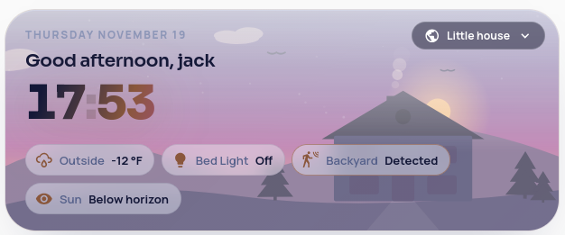

# Aurora Glass Banner Card

A compact, animated Home Assistant Lovelace banner card forked from **Aurora Glass** (`lucalux00/aurora-glass`), keeping the hero greeting panel with a live clock, time-of-day sky & animated worlds, weather/atmosphere effects, and glass pill badges.



## Features

- **10 animated worlds** (`casetta`, `citta`, `montagna`, `mare`, `foresta`, `spazio`, `giappone`, `cyberpunk`, `natale`, `oceano` — English aliases like `house`, `city`, `mountain`, `sea`, `forest`, `space`, `japan`, `christmas`, `ocean` also supported) with continuous day-to-night sky, sun/moon arc, clouds, stars, and glowing windows at night.
- **11 canvas weather & atmosphere effects** (`rain`, `storm`, `snow`, `fog`, `leaves`, `petals`, `fireflies`, `stars`, `fireworks`, `bubbles`, `confetti`, plus Italian keys), with `auto` mode driven by a `weather.*` entity.
- **Compact greeting & live clock** — date eyebrow, time-based greeting (`Good morning`, `Good afternoon`, `Good evening`, `Good night`), and gradient tabular clock.
- **Glass pill badges (`badges`)** — render any Home Assistant entity, attribute, or Jinja2 template in the Aurora Glass pill style with automatic icons, dynamic value-based colors, localized states, and `tap_action` (`more-info`, `toggle`, `navigate`, `url`, `call-service`, `none`).
- **Visual UI Editor + YAML** — configure card options and add, edit, reorder, or remove badges in the Home Assistant UI card editor, or unlock full Jinja2 & color rules in YAML.
- **Auto dark/light theme** — follows Home Assistant's theme or can be forced to `dark` or `light`.

## Installation

### Option 1: HACS (Recommended)

1. Open **HACS** in Home Assistant.
2. Go to **Frontend** (or **Dashboard**) → click the **⋮** menu (top right) → **Custom repositories**.
3. Paste `https://github.com/tadbt/ha-aurora-glass-banner-card` and select category **Dashboard** (or **Lovelace**), then click **Add**.
4. Search for **Aurora Glass Banner Card**, click **Download**, and reload your browser.

### Option 2: Manual Installation

1. Download [`aurora-glass-banner-card.js`](aurora-glass-banner-card.js) from the latest release (or repository root).
2. Copy it into your Home Assistant `www` folder:
   ```text
   /config/www/aurora-glass-banner-card.js
   ```
3. In Home Assistant, go to **Settings → Dashboards → ⋮ (top right) → Resources**.
4. Click **+ Add Resource**, enter `/local/aurora-glass-banner-card.js`, and choose **JavaScript Module**.
5. Hard-refresh your browser (`Ctrl+Shift+R` / `Cmd+Shift+R`).

## Quick Start in Home Assistant

1. Open any dashboard → click **Edit** (pencil icon) → **+ Add Card**.
2. Search for **Aurora Glass Banner Card** (or choose **Manual** at the bottom of the card picker).
3. Use the Visual Editor, or switch to **Show Code Editor** and paste a YAML configuration like the example below:

```yaml
type: custom:aurora-glass-banner-card
world: casetta
effect: auto
weather_entity: weather.home
theme: auto
show_date: true
show_clock: true
show_world_tag: true
hour_24: true
badges:
  - entity: weather.home
    attribute: temperature
    name: Outside
  - entity: light.bedroom
    name: Bed Light
    tap_action:
      action: toggle
  - entity: binary_sensor.backyard_motion
    name: Backyard
    colors:
      "on": "#fb7185"
      "off": "#34d399"
  - entity: sun.sun
    name: Sun
```

## Configuration Reference

### Card Options

| Option | Default | Description |
| --- | --- | --- |
| `world` | `casetta` | Animated world (`casetta`, `citta`, `montagna`, `mare`, `foresta`, `spazio`, `giappone`, `cyberpunk`, `natale`, `oceano`, or English aliases). |
| `effect` | `auto` | Weather/atmosphere overlay: `auto`, `none`, or `rain`, `storm`, `snow`, `fog`, `leaves`, `petals`, `fireflies`, `stars`, `fireworks`, `bubbles`, `confetti`. |
| `weather_entity` | — | Optional `weather.*` entity used when `effect: auto`. |
| `theme` | `auto` | `auto` (follows HA), `dark`, or `light`. |
| `name` | HA user first name | Optional name override for the greeting. |
| `greeting` | auto by hour | Optional custom greeting text. |
| `show_date` | `true` | Show the date eyebrow above the greeting. |
| `show_clock` | `true` | Show the gradient clock. |
| `show_world_tag` | `true` | Show the top-right world pill (click to preview/switch world and effect). |
| `hour_24` | `true` | `true` for 24-hour clock, `false` for 12-hour AM/PM. |
| `language` | `auto` | `auto`, `en`, or `it`. |
| `badges` | `[]` | List of entity IDs or badge objects. |

### Badge Options

Each item in `badges` can be an entity ID string (e.g. `- sun.sun`) or an object:

| Option | Default | Description |
| --- | --- | --- |
| `entity` | — | Home Assistant entity ID. |
| `attribute` | — | Optional attribute to display instead of `state`. |
| `name` | `friendly_name` | Custom label before the value (supports Jinja2 in YAML). |
| `show_name` | `true` | Set `false` to show only icon and value. |
| `show_icon` | `true` | Show entity/custom icon. |
| `show_state` | `true` | Show formatted state/attribute value. |
| `icon` | auto | Override icon, e.g. `mdi:thermometer` (supports Jinja2 in YAML). |
| `unit` | auto | Override unit of measurement (supports Jinja2 in YAML). |
| `value` | auto | Custom value or Jinja2 template (YAML only). |
| `color` | — | Icon color (RGB, CSS color, or Jinja2 in YAML; templates also tint the pill). |
| `colors` | — | Value-based color map or threshold/range rules (YAML only). |
| `badge_color` | — | Custom pill background & border tint (supports Jinja2 in YAML). |
| `precision` | `1` (auto) | Decimal places for numeric values. |
| `tap_action` | `more-info` | Standard HA action (`more-info`, `toggle`, `navigate`, `url`, `call-service`, `none`). |

## Dynamic Colors & Jinja2 Templates (YAML)

In YAML, `name`, `value`, `icon`, `unit`, `color`, and `badge_color` accept Home Assistant Jinja2 templates (`{{ ... }}` / ``). When `entity:` is set on the badge, `entity` is automatically available inside your template.

### 1. Rule-based `colors` (thresholds, ranges, and state maps)

Use `colors` to evaluate the badge's resolved value (or entity state/attribute) without writing a template:

- **Range rules**: `above` (`>`), `below` (`<`), `min` (`>=`), `max` (`<=`), plus optional `default: true` fallback.
- **Numeric thresholds**: `value: 30` matches `>= 30` (highest matching threshold wins).
- **State / string matching**: `state` / `equals` in a list, or a simple key-value map (`"on": "#fb7185"`).

```yaml
badges:
  # Range rule: make red when value > 50
  - entity: sensor.cpu_load
    name: CPU
    colors:
      - above: 50
        color: "#ef4444"   # or "red"
      - default: true
        color: "#22c55e"

  # Multi-step numeric thresholds (>= 30, >= 20, >= 0)
  - entity: weather.home
    attribute: temperature
    name: Outside
    colors:
      - value: 30
        color: "#ef4444"
      - value: 20
        color: "#22c55e"
      - value: 0
        color: "#38bdf8"

  # Simple state map
  - entity: binary_sensor.front_door
    colors:
      "on": "#fb7185"
      "off": "#34d399"
```

### 2. Jinja2 Templates for `color`, `badge_color`, `value`, and `icon`

You can also evaluate colors directly with Jinja2 in `color` (tints the icon and pill border/background) or `badge_color` (overrides just the pill border/background tint):

```yaml
badges:
  - entity: sensor.living_room_humidity
    name: Humidity
    value: "{{ states(entity) | round(0) }}%"
    color: "#ef4444#22c55e"

  - name: Power
    icon: "mdi:flash-alertmdi:flash"
    value: "{{ states('sensor.house_power') }} W"
    color: "#f59e0b#34d399"
    badge_color: "#f59e0b"
```

## Development & Testing

- **Build bundle**:
  ```bash
  npm run build
  ```
- **Test in Docker Home Assistant** (starts Home Assistant on `http://localhost:8123` with `demo:` entities and [docker/config/ui-lovelace.yaml](docker/config/ui-lovelace.yaml)):
  ```bash
  npm run test:ha
  # stop when done:
  npm run test:ha:down
  ```
- **Standalone YAML test harness**: open [src/tests/harness.html](src/tests/harness.html) in a browser to preview and edit card YAML live.
- **Release & tag**:
  ```bash
  ./scripts/release.sh "Release message" 1.0.0
  ```
